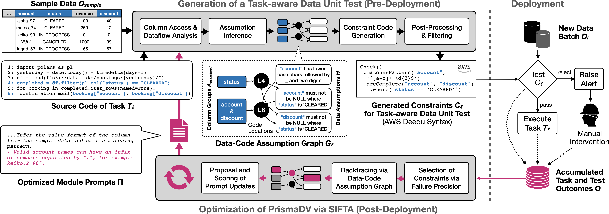

# PrismaDV

**Task-Aware Data Validation using Language Models**

## Architecture

**[PrismaDV](./prismadv)** analyzes downstream task code and sample data to automatically generate validation
constraints. **[SIFTA](./sifta)** (Selective Informative Feedback for Task Adaptation) adapts PrismaDV from observed
task and test outcomes, using failure precision to focus prompt updates on informative constraint failures.



---

### Quick Links to Tables and Figures in the Revised Paper

| Notebook | Reproduces |
|---|---|
| [`workflow_prismadv/results/combined.ipynb`](./workflow_prismadv/results/combined.ipynb) | Table 1; Tables E, H |
| [`workflow_prismadv/results/ablation.ipynb`](./workflow_prismadv/results/ablation.ipynb) | Table 2 |
| [`workflow_sifta/scoring.ipynb`](./workflow_sifta/scoring.ipynb) | Table 3; Table G |
| [`workflow_sifta/ablation.ipynb`](./workflow_sifta/ablation.ipynb) | Table 4; Tables C, D, K |
| [`workflow_prismadv/eid_bench_experiments/results_analysis/cost_runtime_f1_cached.ipynb`](./workflow_prismadv/eid_bench_experiments/results_analysis/cost_runtime_f1_cached.ipynb) | Figure 3 |
| [`workflow_prismadv/results/usage.ipynb`](./workflow_prismadv/results/usage.ipynb) | Table F |
| [`workflow_prismadv/results/per_dataset.ipynb`](./workflow_prismadv/results/per_dataset.ipynb) | Table J |


## Benchmarks

Performance is evaluated using three comprehensive benchmarks for task-aware data validation:

- **[ICDBench](./benchmarks/ICDBench)** - Individual Constraint Discovery (63 test cases)
- **[EIDBench-synth](./benchmarks/EIDBench-synth)** - End-to-End Error Impact Detection (5 datasets, 60 tasks)
- **[EIDBench-real](./benchmarks/EIDBench-real)** - End-to-End Error Impact Detection on 3 real repo-derived tasks

See [**benchmarks overview**](./benchmarks/) for detailed comparison and documentation.

---

### Get Started

1. **Install uv** (if not already installed):
   ```bash
   curl -LsSf https://astral.sh/uv/install.sh | sh
   ```

2. **Install dependencies**:
   ```bash
   uv sync
   ```

3. **Create a `.env` file** with required API keys:
   ```bash
   OPENAI_API_KEY=your_openai_api_key
   GEMINI_API_KEY=your_gemini_api_key
   SPARK_VERSION=3.5
   ```

4. **Run tests**:
   ```bash
   uv run pytest
   ```

### Intermediate Results

All task-aware data validation unit tests are saved in the [`data_processed/`](./data_processed) directory. This
directory contains unit tests for all tasks generated using different approaches.

**Example**: View the data unit tests that PrismaDV (gpt-6-sol) generated
for [general_task_5.py](benchmarks/EIDBench-synth/IPL_win_prediction/scripts/general/general_task_5.py) from the
IPL_win_prediction dataset in
EIDBench-synth [here](./data_processed/IPL_win_prediction/general/constraints/general_task_5/prismadv--gpt-6-sol-medium--20260927_235544.yaml).

The SIFTA and GEPA optimization runs are in [`optimization_runs/`](./optimization_runs): one directory per run, with
its settings and scores in `summary.json` and the program of every round.